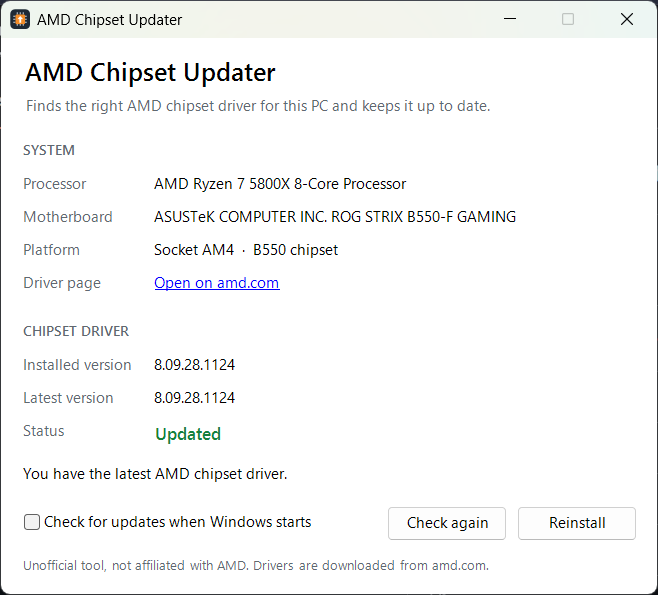
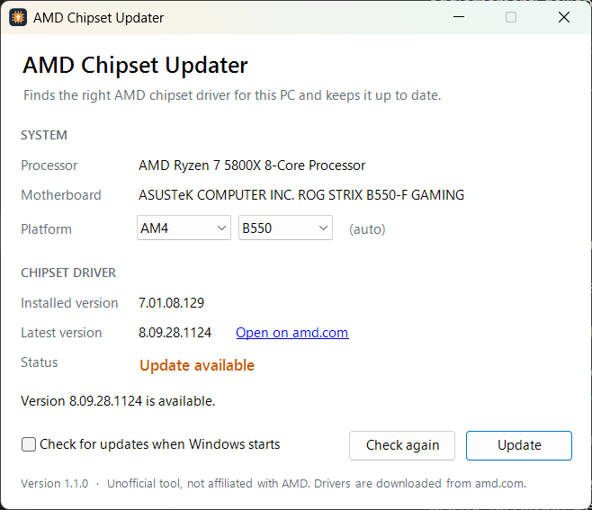
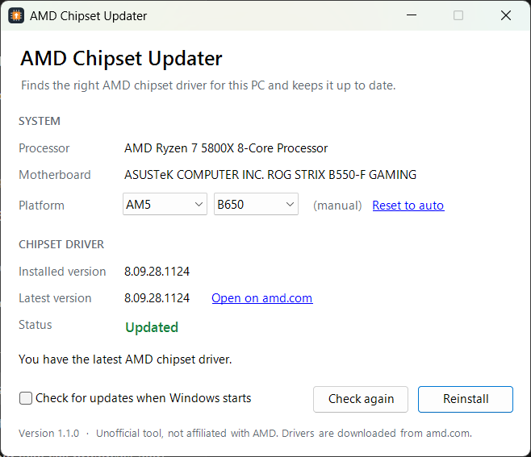
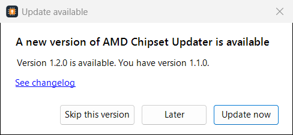

# AMD Chipset Updater

Small Windows app that installs and updates AMD chipset drivers straight from amd.com.

| Up to date | Update available |
|---|---|
|  |  |
| **Platform chosen manually** | **New app version popup** |
|  |  |

## Download

Get it from the [latest release](https://github.com/Maxsenza151/amd-chipset-updater/releases/latest):

| File | Use it if |
|---|---|
| `AMDChipsetUpdater-Setup-<version>.exe` | You want it installed: Start menu entry, uninstaller, optional startup check. No admin rights needed. |
| `AMDChipsetUpdater-Portable-<version>.zip` | You want to run it without installing: extract it anywhere and run the program inside. |

Requires Windows 10/11 (uses the built-in .NET Framework 4.8). The app is not code-signed, so
SmartScreen may warn on first launch ("More info" → "Run anyway").

## How it works

1. **Detection** – reads the CPU (WMI `Win32_Processor`, family/model) to find the socket
   (AM4, AM5, sTR5, sWRX8, sTRX4, TR4, or notebook), then reads the chipset from the
   motherboard name (`Win32_BaseBoard`, e.g. "ROG STRIX B550-F" → B550).
   If the chipset is not detected, or the detection is wrong, pick socket and chipset from the
   **Platform** drop-downs. The choice is saved (`HKCU\Software\AMDChipsetUpdater`), also used by the
   startup check, and **Reset to auto** goes back to automatic detection.
   Non-AMD processors, EPYC servers and AMD processors older than Ryzen are shown as not supported.
2. **Latest version** – opens the matching page
   `amd.com/en/support/downloads/drivers.html/chipsets/<socket>/<chipset>.html` and takes the
   `amd_chipset_software_<version>.exe` link. Falls back to the socket's default page.
3. **Installed version** – `DisplayVersion` of "AMD Chipset Software" in the Uninstall registry keys.
4. **Status** – `Updated` or `Update available` (or `Not installed`).
5. **Install / Update** – downloads with the `Referer: https://www.amd.com/` header (required by
   AMD), checks the Authenticode signature is valid and from *Advanced Micro Devices*,
   then runs the installer elevated (UAC).

## App updates

When the window opens, the app reads the latest release of this repository from the GitHub API.
If it is newer, a popup offers **Update now**, **Later** or **Skip this version**, with a
**See changelog** link to the release page.

- **Installed copy**: downloads the new setup and runs it silently; it updates the files and reopens the app,
  keeping the "Check for updates when Windows starts" setting as it is. A running startup check is closed
  first; if another window of the app is open, you are asked to close it.
- **Portable copy**: downloads the new zip, renames the running exe to `.old`, puts the new one in its
  place and restarts (the `.old` file is removed on the next start).

The downloaded file must match the SHA-256 checksum GitHub publishes for the release asset,
otherwise it is deleted. The startup check (below) only looks for driver updates.

## Startup check

`AMDChipsetUpdater.exe --check` (registered in `HKCU\...\Run` by the checkbox or the installer):
no window, below-normal priority, retries up to 3× if the network isn't ready, shows a Windows
notification only if an update is available or the driver is not installed, then exits.
Exit codes: `0` up to date, `1` notified, `2` error. `--check --force-notify` always notifies (testing).

## Build

Needs only Windows' built-in C# compiler (.NET Framework 4.8). Inno Setup 6 is required for the installer
(`winget install JRSoftware.InnoSetup`).

```powershell
powershell -ExecutionPolicy Bypass -File build.ps1
```

The portable zip and the installer are written to `dist\`. The version comes from `src\AssemblyInfo.cs`;
publish a release with the tag `v<version>` and both files attached so existing copies can update.

## Source

- `src\HardwareDetector.cs` – CPU/board detection and platform → AMD page mapping
- `src\AmdDriverSource.cs` – page parsing and download
- `src\InstalledDriver.cs` – installed version from the registry
- `src\SignatureVerifier.cs` – Authenticode check (WinVerifyTrust)
- `src\UpdateChecker.cs` – ties the above together
- `src\Settings.cs` – manual platform and skipped app version
- `src\AppUpdater.cs`, `src\AppUpdateDialog.cs` – app self-update from GitHub releases
- `src\Http.cs` – shared download code
- `src\MainForm.cs` – UI
- `src\BackgroundCheck.cs` – `--check` mode and notification
- `src\Autostart.cs` – startup entry
- `installer\setup.iss` – Inno Setup script

## License

[MIT](LICENSE). Unofficial tool, not affiliated with AMD. AMD drivers are downloaded from amd.com
and remain subject to AMD's own license terms.
